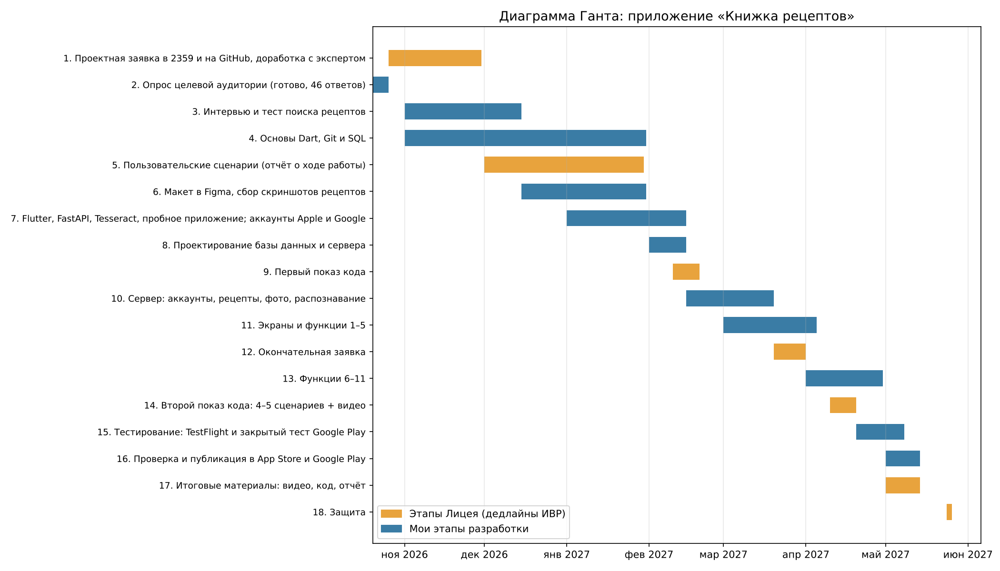

# Заявка на проект: «Книжка рецептов»

**Автор:** [Новикова Мария], [10и7]
**Тип проекта:** индивидуальный, область IT
**Продукт:** мобильное приложение для iPhone и Android с сервером, публикация в App Store и Google Play. Главная функция - добавление рецептов со скриншотов и фото с распознаванием текста.

## 1. Проблемное поле

Многие люди готовят дома каждый день и берут рецепты из разных мест: сайты, видео, соцсети, переписки с родными, старые тетрадки. Чтобы не потерять рецепт, его обычно сохраняют как получится, чаще всего просто делают скриншот.

Чтобы проверить, насколько это реальная проблема, я провела опрос в Яндекс Формах (15 вопросов, 46 человек):

- 72% хранят рецепты в виде скриншотов и фото, ещё треть - в закладках браузера и заметках телефона. Почти у всех рецепты лежат сразу в нескольких местах.
- 93% хотя бы иногда теряли рецепт, а 28% теряют часто.
- У половины опрошенных поиск нужного рецепта занимает больше трёх минут, а 7% часто вообще не могут его найти.
- 72% никогда не пользовались приложениями для рецептов, а 22% пробовали и бросили. Самая частая причина - «привычнее по-старому» (39%). Ещё мешают реклама (17%) и платные функции (15%).
- Больше всего людям не хватает быстрого поиска (76%) и подбора блюда из продуктов, которые есть дома (76%). Почти половине нужен пересчёт порций (48%), 41% - меню на неделю.
- Лишними функциями люди чаще всего называют заказ продуктов (43%) и комментарии с соцсетями (37%).

Получается, что проблема не в том, что у людей нет приложений, а в том, что приложения требуют переписывать рецепты вручную, а людям проще сделать скриншот. В итоге рецепты копятся в галерее вперемешку с другими фото, их трудно найти, и с ними ничего нельзя сделать: ни найти по ингредиенту, ни пересчитать на другое число порций, ни понять, что приготовить из того, что есть в холодильнике.

Я хочу сделать приложение, которое не заставляет менять привычку: человек делает скриншот, как раньше, загружает его в приложение, и оно само распознаёт текст и превращает его в нормальный рецепт с ингредиентами и шагами.

**Как я ещё буду проверять проблему:**
- Интервью с 6-8 людьми из разных групп целевой аудитории, примерно по 10 вопросов.
- Тест: 5 человек ищут нужный рецепт среди своих скриншотов и добавляют рецепт в 2-3 популярных приложения, а я засекаю время и считаю действия.

**Как я пойму, что у меня получилось:**
- добавить рецепт со скриншота получается не дольше чем за 1 минуту;
- распознавание правильно раскладывает рецепт на ингредиенты и шаги хотя бы в 8 случаях из 10 для скриншотов с печатным текстом;
- найти рецепт в приложении получается быстрее, чем среди своих скриншотов (те же люди, те же задания);
- не меньше 70% тестировщиков ставят удобству 4 или 5 из 5;
- хотя бы половина тестировщиков продолжает пользоваться приложением через две недели.

## 2. Целевая аудитория

Заказчика у проекта нет. По опросу, 43% готовят каждый день, а половина готовит на 3–4 человек.

1. **Мамы и хозяйки 35–54 лет** (72% опрошенных). Готовят почти каждый день на всю семью, рецептов много, и хранятся они где попало. Телефоном пользуются уверенно, но приложениями для рецептов почти не пользуются, потому что привыкли к скриншотам. Им важно быстро найти рецепт и понять, что приготовить из того, что есть дома.
2. **Молодые люди до 34 лет.** Готовят реже, рецепты в основном берут из интернета и соцсетей и сохраняют скриншотами. Им важно сохранить рецепт за пару секунд и быстро найти потом.
3. **Родственники и друзья, с которыми делятся рецептами.** 80% опрошенных пересылают рецепты в мессенджерах. Этим людям важно получить рецепт в удобном виде и сохранить к себе, а не искать потом в переписке.

## 3. Аппаратные и программные требования

- **Телефон на Android:** Android 8.0 и новее, процессор 4 ядра от 1,8 ГГц, от 2 ГБ оперативной памяти, от 200 МБ свободного места, интернет.
- **iPhone:** iOS 15 и новее (iPhone 8 и более новые модели), от 200 МБ свободного места, интернет.
- **Сервер:** Linux (Ubuntu 22.04), 2 ядра, 2 ГБ оперативной памяти (нужно для распознавания текста), диск 20 ГБ, PostgreSQL 15, Tesseract 5 с русским языком.

Требования уточню после первых сборок.

## 4. Функциональные требования

1. Регистрация, вход по почте и паролю, восстановление пароля, изменение профиля и удаление аккаунта.
2. Добавление рецепта вручную (название, фото, ингредиенты с количеством, шаги, время, число порций), его редактирование и удаление.
3. **Добавление рецепта со скриншота или фото (главная функция):** приложение распознаёт текст, само раскладывает его на название, ингредиенты и шаги, а пользователь проверяет и поправляет.
4. Категории, теги и избранное.
5. Быстрый поиск по названию и ингредиентам, фильтры по категории и времени приготовления.
6. **Подбор блюда из продуктов, которые есть дома (главная функция):** отмечаешь продукты, и приложение показывает, что можно приготовить, начиная с рецептов, для которых всё есть.
7. Пересчёт ингредиентов на нужное число порций.
8. Меню на неделю из своих рецептов.
9. Список покупок из рецептов или из меню: одинаковые продукты складываются, купленное можно отмечать.
10. Отправка рецепта в мессенджер (текстом или ссылкой) и добавление присланного рецепта к себе одним нажатием.
11. Экспорт рецепта или всей книжки в PDF и резервная копия в файл.

## 5. Похожие приложения

1. **Paprika Recipe Manager.** Платное: мобильная версия и версия для компьютера покупаются отдельно, оплатить из России сложно. Оно в основном про сохранение рецептов с англоязычных сайтов.
2. **Cookmate.** Много функций, которые не нужны для хранения своих рецептов: импорт с более чем 150 сайтов, темы, голосовое чтение, отправка в соцсети. При этом меню на неделю и списки покупок только в премиум-версии.
3. **Галерея со скриншотами, заметки в телефоне.** Рецепты лежат вперемешку с другим, ингредиенты не отделены от шагов, поэтому нельзя пересчитать порции, подобрать рецепт по продуктам или собрать список покупок.
4. **Кулинарные сайты (Поварёнок.ру, Food.ru).** Они для поиска чужих рецептов, хранить на них свои рецепты из разных мест не получится.

## 6. Инструменты разработки и база данных

- **Приложение:** Dart и Flutter. Из одного кода получаются приложения и для iPhone, и для Android (в опросе у 72% iPhone, у 28% Android). Сборка для iPhone - в Xcode на Mac. Стиль кода - по руководству Effective Dart, проверка через `flutter analyze`.
- **Сервер:** Python 3.12 и FastAPI, SQLAlchemy, пароли в зашифрованном виде (bcrypt), вход через токены JWT. Стиль кода - PEP8.
- **Распознавание текста:** Tesseract 5 (через pytesseract) с русским языком, предварительная обработка картинки - Pillow. Деление текста на название, ингредиенты и шаги - мои правила на Python.
- **База данных:** PostgreSQL. Это табличная база данных, она хорошо подходит для связанных данных (пользователи, рецепты, ингредиенты, меню, списки покупок). Фото и скриншоты храню файлами на сервере, в базе - ссылки.
- **Раздача и публикация:** TestFlight и App Store Connect, Google Play Console (закрытое тестирование и публикация).
- **Остальное:** VS Code, Android Studio, Xcode, Git и GitHub, Figma, Postman.

## 7. Этапы разработки

1. 26.10.2026 - 30.11.2026 - проектная заявка в 2359 и на GitHub, доработка с экспертом.
2. Октябрь 2026 - опрос целевой аудитории (готово, 46 ответов).
3. 01.11.2026 - 15.12.2026 - интервью и тест (поиск рецептов в скриншотах и в аналогах).
4. 01.11.2026 - 31.01.2027 - основы Dart, Git и SQL.
5. 01.12.2026 - 30.01.2027 - пользовательские сценарии (отчёт о ходе работы).
6. 15.12.2026 - 31.01.2027 - макет в Figma, сбор 50-100 скриншотов рецептов для проверки распознавания.
7. 01.01.2027 - 15.02.2027 - Flutter, FastAPI и Tesseract, пробное приложение для iPhone и Android, регистрация аккаунтов разработчика Apple и Google.
8. 01.02.2027 - 15.02.2027 - проектирование базы данных и сервера.
9. Февраль 2027 - первый показ кода (first_code.md).
10. 15.02.2027 - 20.03.2027 - сервер: аккаунты, рецепты, фото, распознавание текста.
11. 01.03.2027 - 05.04.2027 - экраны и функции 1-5.
12. До 01.04.2027 - окончательная заявка (final_application.md, final_scripts.md, changes.md).
13. 01.04.2027 - 30.04.2027 - функции 6-11.
14. Апрель 2027 - второй показ кода: 4-5 сценариев и видео (second_code.md).
15. 20.04.2027 - 08.05.2027 - запуск сервера, тестирование через TestFlight и закрытое тестирование Google Play, повторный опрос, исправление ошибок.
16. 01.05.2027 - 14.05.2027 - проверка и публикация в App Store и Google Play.
17. До 14.05.2027 - итоговые материалы: видео, код, отчёт.
18. 25.05.2027 - защита.

Даты показов кода уточню по объявлениям в Элжуре и 2359.

## 8. Возможные риски

1. **Новые технологии.** До этого я программировала только на Python, а для проекта нужно освоить новый язык Dart, фреймворк Flutter, разработку сервера, базы данных и распознавание текста. *Что сделаю:* выделяю на учёбу ноябрь-февраль, начинаю с маленьких учебных проектов, хожу на консультации к эксперту и студентам-консультантам, занимаюсь 8-10 часов в неделю. Сервер пишу на Python, который уже знаю. В феврале на контрольной точке вместе с экспертом оценю, успеваю ли, и если нет — договорюсь о переносе защиты на осень.
2. **Распознавание может плохо работать.** Скриншоты бывают очень разные: текст поверх картинок, несколько колонок, рукописный текст, а разделить текст на ингредиенты и шаги — отдельная непростая задача. *Что сделаю:* обещаю распознавание только печатного текста, заранее соберу 50-100 настоящих скриншотов и проверю на них Tesseract ещё в феврале. Пользователь всегда видит результат и может его поправить, поэтому даже неидеальное распознавание экономит время.
3. **Сложности с Dart и Flutter.** Это новый для меня язык. *Что сделаю:* учу Dart параллельно с подготовкой сценариев и в январе-феврале делаю пробное приложение для обеих систем, чтобы заранее увидеть проблемы.
4. **Приложение могут не пропустить в App Store или Google Play, или проверка затянется; может не получиться оплатить аккаунты разработчика из России.** Google Play для новых аккаунтов требует 14 дней закрытого тестирования минимум с 12 тестировщиками, а оба магазина требуют политику конфиденциальности и удаление аккаунта. *Что сделаю:* регистрирую аккаунты в январе–феврале, заранее читаю правила магазинов, закрытое тестирование начинаю не позже 20 апреля. Если публикация не успеет к защите, приложение будет у тестировщиков через TestFlight и Google Play, а на Android его можно поставить файлом APK.
5. **Может не получиться запустить сервер в интернете** (настройка, HTTPS, оплата). *Что сделаю:* в феврале потренируюсь на учебном проекте, при проблемах с оплатой возьму бесплатный тариф облачного хостинга.
